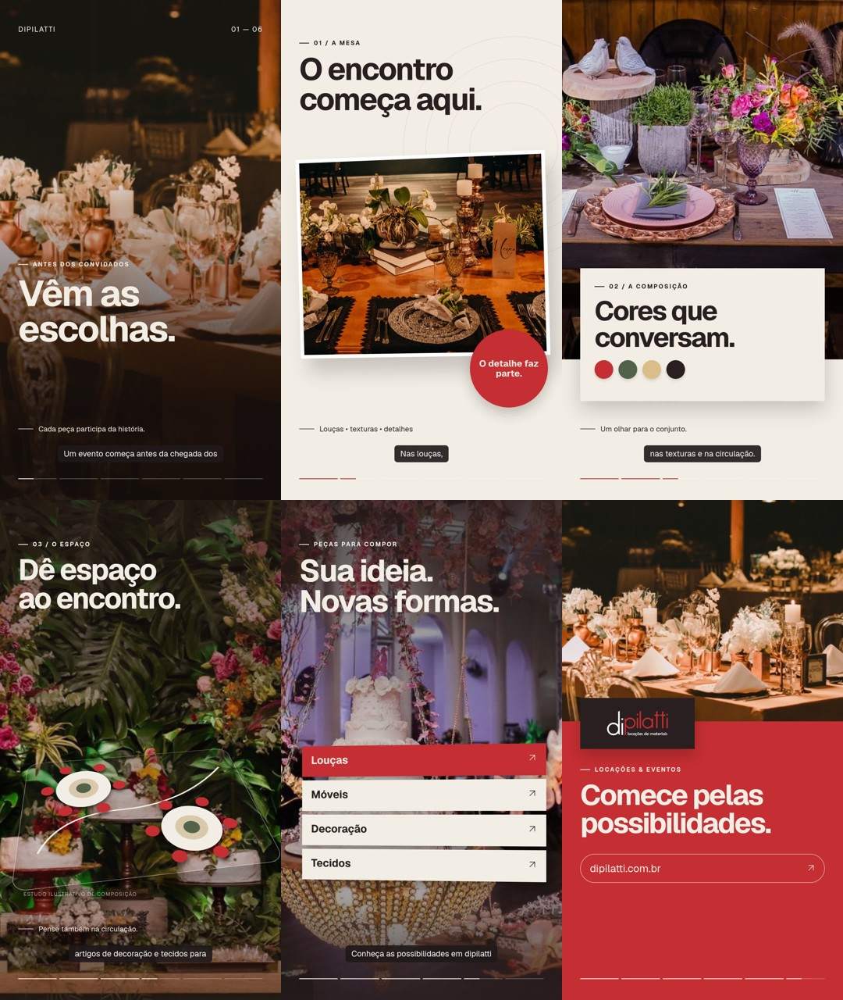

# B-roll Studio

**Uma temática vira um vídeo narrado, com pesquisa e identidade adaptada à sua marca.** Skill para agentes de IA, acompanhada de um exemplo completo e reproduzível de 30 segundos.

Informe o assunto. Opcionalmente, acrescente o nome da marca, logotipo ou site. O agente pesquisa, desenvolve roteiro e direção, prepara mídia, monta, revisa e entrega o vídeo. Sem avatar por padrão; câmera livre, imagens grandes e movimento com propósito.



[Baixar a skill](dist/broll-studio.skill) · [ZIP da skill](dist/broll-studio.zip) · [Assistir ou baixar o exemplo de 30 segundos](examples/dipilatti/output/video.mp4) · [Dashboard local](docs/index.html) · [Skill](.agents/skills/broll-studio/SKILL.md) · [Fontes e direitos](THIRD_PARTY.md)

## Usar a skill

Copie a pasta `.agents/skills/broll-studio/` inteira para a pasta de skills do seu agente. Em agentes compatíveis com a convenção `.agents/skills`, mantenha esse caminho no projeto. Se o agente usar outra convenção, adapte somente o diretório de instalação. Não substitua skills existentes: o identificador desta é `broll-studio`.

Exemplos:

> Use $broll-studio. Tema: como escolher plantas para um apartamento.

> Use $broll-studio. Marca: Minha Marca. Site: https://exemplo.com. Tema: como escolher o produto ideal. Faça um vídeo de 30 segundos.

> Use $broll-studio com este logotipo. Explique o tema X e use um tom acolhedor.

A skill depende das capacidades do agente para pesquisar, gerar mídia e sintetizar voz. **Não é um serviço hospedado nem um aplicativo de geração autônoma sem modelo de IA.** Não inclui contas, créditos ou credenciais. As instruções permitem escolher provedores disponíveis e registrar limitações. Nome de marca ambíguo pode exigir esclarecimento; somente tema pode usar identidade editorial provisória.

## Reproduzir o exemplo

Requisitos: Node.js 22 ou superior, npm e FFmpeg. Para reconstruir o áudio, Python 3; o áudio já pronto acompanha o projeto. O Remotion precisa de um navegador compatível e bibliotecas de sistema. Consulte a [instalação oficial](https://www.remotion.dev/docs/renderer).

```bash
npm ci
npm run check
npm test
npm run validate
npm run render
```

O vídeo será salvo em `examples/dipilatti/output/video.mp4`: 1080 × 1920, 30 fps, 30 segundos, H.264/AAC. O primeiro uso pode baixar o navegador. Para usar um Chromium já instalado:

```bash
CHROME_PATH=/usr/bin/chromium npm run render
```

Windows PowerShell: `$env:CHROME_PATH='C:\caminho\chrome.exe'` antes do comando. Não configure o caminho se quiser usar o navegador gerenciado pelo Remotion.

```bash
npm run dev        # editor e playback no navegador
npm run stills     # seis quadros para revisão
python scripts/prepare-audio.py  # refaz trilha original, mix e legendas
```

O render não chama APIs de IA. Voz, fotos, logo e fontes da demonstração estão incluídos com procedência e condições próprias. A reprodução do áudio é determinística a partir do WAV incluído; regenerar a locução é opcional e depende de um provedor autorizado.

## Começar um projeto novo

```bash
npm run new -- --topic "Como escolher o café" --brand "Minha Marca" --website "https://exemplo.com" --slug cafe
```

Também aceita `--logo ./meu-logo.png`. Só `--topic` é obrigatório. O comando cria `projects/cafe/brief.json` e `START.md`, sem sobrescrever projetos existentes. **É um scaffolding de briefing:** entregue essa pasta ao agente com a skill para pesquisar e produzir. Não reutiliza a marca nem os assets da demonstração.

Para usar o renderizador de exemplo, o agente prepara seis cenas no formato de `examples/dipilatti/project.json`, coloca os novos assets em `public/` e executa:

```bash
npm run render -- --project projects/cafe/project.json --out projects/cafe/final
```

O layout incluído demonstra uma direção editorial fotográfica com planos 2.5D. Para outras narrativas, altere ou crie uma composição em `src/`; a skill não se limita a seis cenas ou a essa estética. Todos os textos comerciais pertencem ao exemplo, não à skill. Veja [o fluxo de adaptação](docs/WORKFLOW.md).

## O que acompanha o kit

- Skill genérica e quatro referências de pesquisa, direção, produção e distribuição.
- Renderizador editável em React/Remotion, dependências fixadas e testes de entrada.
- Demonstração Dipilatti: roteiro, identidade observada, pesquisa, manifesto, mídia, voz pública, legendas, storyboard, MP4 e relatório de verificação.
- Síntese original de trilha e efeitos, sem música comercial embutida.
- Dashboard HTML local; abra `docs/index.html` depois de clonar o repositório.

## Limites e licenças

Código e documentação originais: MIT. Logo e fotografias comerciais **não são licenciados sob MIT**; pertencem aos respectivos titulares e estão identificados no exemplo. A demonstração não indica parceria ou endosso oficial. Substitua-os ao criar vídeos para outra marca. Voz sintetizada e fontes possuem condições próprias. Leia [THIRD_PARTY.md](THIRD_PARTY.md).

O Remotion tem licença própria, com condições comerciais que dependem do uso e da organização. Consulte [remotion.dev/license](https://www.remotion.dev/license). A licença deste kit não substitui as licenças das dependências.

Pesquisa web exige acesso à internet; geração por provedores pode ter custo e limites. Sites indisponíveis, permissões de mídia e falta de ferramenta devem ser relatados, nunca ocultados. O relatório do exemplo distingue verificações executadas de verificações não realizadas.

## Problemas comuns

- **Navegador não inicia:** confira as bibliotecas de sistema e `CHROME_PATH`; siga a documentação oficial do Remotion.
- **Ambiente bloqueia servidor local/rede:** o renderer precisa iniciar um servidor local. Habilite a capacidade no ambiente autorizado; não altere código de dependências para mascarar falhas.
- **Asset ausente:** caminhos são relativos a `public/`, sem barra inicial. Execute `npm run validate -- caminho/project.json`.
- **Memória limitada:** use `RENDER_CONCURRENCY=1 npm run render`.
- **Logo pouco legível:** use a variante clara/escura original e adapte o fundo; preserve a proporção.
